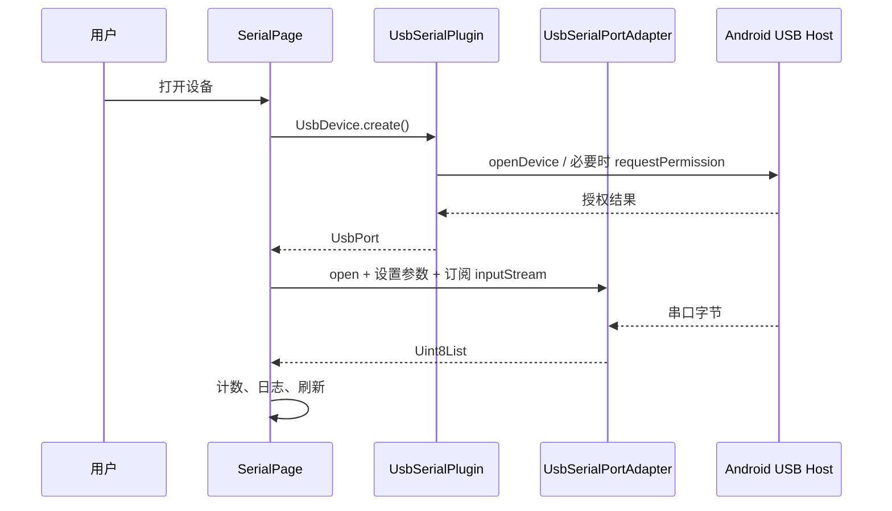

# 事件、字节流与平台通道

范围：当前 Android 前台实现。Flutter 页面状态在 `lib/main.dart`；TCP Socket 和订阅在 `lib/tcp_transport.dart`；USB 原生实现位于 `third_party/usb_serial`；文件操作位于 `MainActivity.kt`。

| 流程 | 生产/注册 | 分发与处理 | 负载/生命周期 |
| --- | --- | --- | --- |
| USB 插拔 | `UsbSerialPlugin.register()` 注册 Android `BroadcastReceiver`；`UsbSerial.usbEventStream` 建立 `usb_serial/usb_events` 订阅 | `UsbSerialPlugin.usbReceiver.onReceive()` 发出 `UsbEvent`；`_SerialPageState.initState()` 的监听重扫，匹配拔出的已选设备时 `_disconnect()` | 设备信息和 attached/detached 类型；页面 `dispose()` 取消订阅，插件 `unregister()` 移除接收器。 |
| 枚举/打开 | `_scanDevices()` 调 `UsbSerial.listDevices()`；用户调用 `_connect()`/`UsbDevice.create()` | `UsbSerialPlugin.onMethodCall()` 分发 `listDevices`/`create`；`openDevice()` 必要时 `acquirePermissions()`，授权结果由临时广播接收器回调，再创建 `UsbSerialPortAdapter` | USB 设备信息、端口句柄；权限由 Android 弹窗决定，`_generation` 防止过期结果接管页面。 |
| TCP 客户端 | 页面调用 `TcpTransport.connect(host, port)` | `Socket.connect()` 建立连接，订阅字节流；`onStateChanged` 回调页面更新状态/系统日志 | 连接超时或失败显示错误；不自动重连。关闭和切换会使过期连接结果失效。 |
| TCP 服务端 | 页面调用 `TcpTransport.listen(port)` | `ServerSocket.bind()` 监听所有 IPv4 网卡，接受一个客户端并订阅其字节流 | 已有客户端时关闭额外连接；客户端断开后继续监听，`close()` 才停止服务。没有客户端时不能发送。 |
| 接收 | USB 的 `port.inputStream` 或 TCP 的 `onData` | USB 回调经主线程 `EventSink`，TCP 经 Dart Socket 事件；均进入 `_onReceived()` 更新计数/日志，`_scheduleRefresh()` 延迟重绘 | `Uint8List` 字节块；断开时取消订阅并关闭端口/Socket。块边界不是协议帧边界，TCP 可能拆包或合包。 |
| 发送 | `_send()` 以 `parseHex()` 或 `encodeText()` 生成字节；`_sendFile()` 从缓存文件每次读取 4096 字节 | 按当前方式调用 `UsbPort.write()` 或 `TcpTransport.write()`；TCP 写入并刷新 Socket 缓冲 | 发送成功后更新 TX 计数和日志；写入完成不代表对端业务已处理。重复发送计时器由 `_stopRepeat()` 取消。 |
| 切换通信方式 | 用户选择 USB 串口/TCP 服务端/TCP 客户端 | 页面关闭原端口或 TCP 传输，停止定时发送，中断未完成文件发送 | 一次使用一个传输，已有日志和记录设置保留；不自动桥接或转发。 |
| 文件选择/日志保存 | `_sendFile()`/`_saveLog()` 调 `phone_comm/files` | `MainActivity.configureFlutterEngine()` 注册 `pickFile`/`saveLog`；`onActivityResult()` 处理 Android 文档选择器结果 | 选择文件被复制到缓存，Dart 发送后删除；日志用 UTF-8 写用户选定 URI。一次只保留一个 `pendingResult`。 |
| 实时记录 | `_record()` 缓存日志行，`_scheduleRefresh()` 约每 80 毫秒刷新并调用 `_flushRecording()` | `phone_comm/files` 的 `startRecording`/`appendRecording`/`stopRecording` 经 `MainActivity` 的单线程执行器写文件 | 文件时间戳由启动记录时的选项确定，独立于界面时间戳；停止时等待排队写入后关闭文件。Android 10+ 存在 `下载/PhoneComm/`。 |

执行上下文：Dart 页面与 TCP 回调在 Flutter UI isolate；插件 USB 广播及 `MethodChannel` 回调由 Android 插件处理，端口读回调通过 `Handler(Looper.getMainLooper())` 发送给 Flutter。Android 主清单的 `INTERNET` 权限同时覆盖调试和发布构建。这里描述代码路径，不代表目标手机的 USB、局域网互连或后台运行已经实测；验证步骤见 [README](../../README.md#tcp-连接与验证)。
